<!-- Pre-rendered so the models are not refitted on every build. To update, edit
     eyethinkbayes-vignette.Rmd.orig, then in vignettes/ run
     knitr::knit("eyethinkbayes-vignette.Rmd.orig", output = "eyethinkbayes-vignette.Rmd") -->


This is a toolbox for running and plotting bayesian mixed models. Here's how to get the latest version of the toolbox. Note that there are hefty packages that will be needed for this to work, like rstanarm, so installation might take a while. 


```r
devtools::install_github("dcr-eyethink/eyethinkbayes")
```


```r
library(eyethinkbayes)
#> Loading required package: eyethinkdata
#> Loading required package: ggplot2
#> Loading required package: data.table
```

Usually, I use the wrapper command bayes_mm() to call a series of functions that run, analyse, report and plot a model in all one step. In this vignette I'm going to first show you each of those functions in turn to break down what they do. Then we'll return to the wrapper function that can do it in one step. 

We're going to work on some behavioural data from an experiment in which people watched TV shows and adverts. We are interested in whether they prefer and remember ads that are 'addressable'. This means that the ads are related to their personal interests in some way. First let's read in the trial data  


```r
data <- data.table(read.csv("ad_data.csv"))
knitr::kable( head(data))
```


|     pid|dim    |adcon       |tv     | rating| age|agecat |    dprime|
|-------:|:------|:-----------|:------|------:|---:|:------|---------:|
| 6700131|car    |addressable |choice |   1.00|  27|18_34  | 0.9674216|
| 6700131|cruise |addressable |choice |   3.25|  27|18_34  | 0.0000000|
| 6700131|dog    |non-address |choice |   4.75|  27|18_34  | 1.2496377|
| 6700131|games  |non-address |choice |   0.25|  27|18_34  | 0.2822161|
| 6700745|car    |non-address |choice |   0.00|  43|35.54  | 0.0000000|
| 6700745|cruise |non-address |choice |  -3.00|  43|35.54  | 1.0037630|


Participants of difference ages saw four ads in for four different dimensions (dim) that could be addressed to the interests or not (adcon). They watched a TV show that they chose or not (tv). Here we have summary data for each dimension: how much they liked the adverts (rating), and their memory for them when shown stills later (dprime).

## Running a model

First we are going to run a bayesian mixed model on their rating data, to see if they liked the addressable ads more. This command will create a formula for the model using the conditions you specify as fixed effects, and the groups as random effects. Rstanarm is used to run the model. This may take some minutes to run. There is a parameter here, explore_browser, which if set to TRUE will launch a browser window with an interactive interface that you can use to explore plots and parameters of your model, check its convergence and so on. 


```r
memory_bmm <- bayes_mm_run(data = data,dvname="dprime",conditions = c("adcon","age","tv"),groups = c("pid","dim"),
                           explore_browser = F)
#> [1] "running model"
```
Now that we have run the model, we can pass the output to different functions for the plotting and reporting. 

## Main effects

First, we can look at the main effects. The function bayes_mm_mainFX() will give you means tables, MPEs and contrast for all the main effects you ask for. This will be saved to a text file. The plots show you the observed data (violin) and the distribution of the estimate of the mean (smaller violins).  If we don't specify the mainfx arg it will give us all main effects, but here I'm looking at the effect of adcon. 


```r
mfx <- bayes_mm_mainFX(bmm = memory_bmm,mainfxs = "adcon")
#> NOTE: Results may be misleading due to involvement in interactions
#> 
#> Main effects means:  adcon 
#> Estimated Marginal Means
#> 
#> adcon       | Mean |       95% CI |   pd
#> ----------------------------------------
#> addressable | 0.77 | [0.57, 0.97] | 100%
#> non_address | 0.60 | [0.41, 0.79] | 100%
#> 
#> Marginal means estimated at adcon
#> NOTE: Results may be misleading due to involvement in interactions
#> 
#> Main effects contrasts:  adcon 
#> Marginal Contrasts Analysis
#> 
#> Level1      |      Level2 | Difference |       95% CI |   pd | % in ROPE
#> ------------------------------------------------------------------------
#> addressable | non_address |       0.17 | [0.09, 0.25] | 100% |     2.05%
#> 
#> Marginal contrasts estimated at adcon
#> NOTE: Results may be misleading due to involvement in interactions
#> Warning in set(x, j = name, value = value): Tried to assign NULL to column
#> 'pid', but this column does not exist to remove
mfx$plot_mainfx
```

<div class="figure">
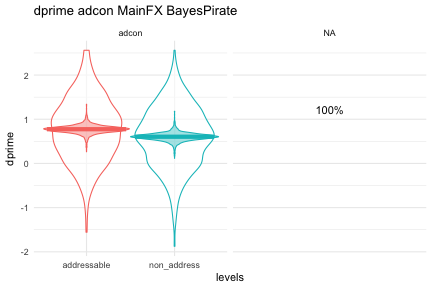
<p class="caption">plot of chunk unnamed-chunk-5</p>
</div>

Here, the MPE is given inbetween the two plots, and is the probability that there is non zero difference between those two conditions. We can also represent the difference between conditions using sparkline. It shows, beneath the means plots, the distribution of the estimate of the condition difference. 95% of the distribution is shaded in grey, and zero is shown by a vertical black line. So if the black line is outside the grey shaded area, there is a greater than 95% chance that there is a non zero difference between the means. In the plot below I've turned on the sparkline, and turned off the mpes and the predicted distribution of the means. I can also change the plotting here by passing parameters to pirateye(). So here I've drawn bars, and they've been plotted on a composite plot. These plots are also saved to files, and the w and h parameters control the height and width of the saved pdfs.


```r
 bayes_mm_mainFX(bmm = memory_bmm,mainfxs = c("adcon","tv"),bars=T,violin=F,contrast_sparkline = T,show_mpe = F,show_preddist = F)
#> NOTE: Results may be misleading due to involvement in interactions
#> 
#> Main effects means:  adcon 
#> Estimated Marginal Means
#> 
#> adcon       | Mean |       95% CI |   pd
#> ----------------------------------------
#> addressable | 0.77 | [0.57, 0.97] | 100%
#> non_address | 0.60 | [0.41, 0.79] | 100%
#> 
#> Marginal means estimated at adcon
#> NOTE: Results may be misleading due to involvement in interactions
#> 
#> Main effects contrasts:  adcon 
#> Marginal Contrasts Analysis
#> 
#> Level1      |      Level2 | Difference |       95% CI |   pd | % in ROPE
#> ------------------------------------------------------------------------
#> addressable | non_address |       0.17 | [0.09, 0.25] | 100% |     2.05%
#> 
#> Marginal contrasts estimated at adcon
#> NOTE: Results may be misleading due to involvement in interactions
#> NOTE: Results may be misleading due to involvement in interactions
#> 
#> Main effects means:  tv 
#> Estimated Marginal Means
#> 
#> tv     | Mean |       95% CI |   pd
#> -----------------------------------
#> choice | 0.68 | [0.48, 0.88] | 100%
#> random | 0.69 | [0.49, 0.89] | 100%
#> 
#> Marginal means estimated at tv
#> NOTE: Results may be misleading due to involvement in interactions
#> 
#> Main effects contrasts:  tv 
#> Marginal Contrasts Analysis
#> 
#> Level1 | Level2 | Difference |        95% CI |     pd | % in ROPE
#> -----------------------------------------------------------------
#> choice | random |  -9.21e-03 | [-0.15, 0.12] | 55.33% |    91.34%
#> 
#> Marginal contrasts estimated at tv
#> NOTE: Results may be misleading due to involvement in interactions
#> Warning in set(x, j = name, value = value): Tried to assign NULL to column
#> 'pid', but this column does not exist to remove
#> $plot_mainfx
```

<div class="figure">
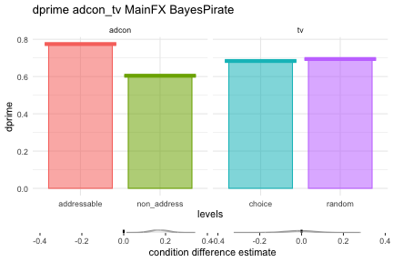
<p class="caption">plot of chunk unnamed-chunk-6</p>
</div>

```
#> 
#> $data_mainfx
#> $data_mainfx$observed
#>           dprime condition      levels
#>            <num>    <fctr>      <fctr>
#>    1:  0.9674216     adcon addressable
#>    2:  0.0000000     adcon addressable
#>    3:  1.2496377     adcon non_address
#>    4:  0.2822161     adcon non_address
#>    5:  0.0000000     adcon non_address
#>   ---                                 
#> 1604: -0.2822161        tv      random
#> 1605:  1.0037630        tv      random
#> 1606:  1.3110027        tv      random
#> 1607:  1.5932188        tv      random
#> 1608:  1.2496377        tv      random
#> 
#> $data_mainfx$predicted
#> Null data.table (0 rows and 0 cols)
#> 
#> $data_mainfx$m
#>    condition      levels    dprime
#>       <char>      <fctr>     <num>
#> 1:     adcon addressable 0.7744530
#> 2:     adcon non_address 0.6043145
#> 3:        tv      choice 0.6835353
#> 4:        tv      random 0.6940913
#> 
#> $data_mainfx$mpe
#> Null data.table (0 rows and 0 cols)
#> 
#> $data_mainfx$bcontrasts
#> Index: <cond>
#>         cond    diff_est
#>       <char>       <num>
#>    1:  adcon  0.26136495
#>    2:  adcon  0.14887548
#>    3:  adcon  0.17830607
#>    4:  adcon  0.14912859
#>    5:  adcon  0.15556333
#>   ---                   
#> 7996:     tv -0.12037912
#> 7997:     tv -0.08646035
#> 7998:     tv  0.03796477
#> 7999:     tv -0.10194506
#> 8000:     tv -0.01695974
```


## Interactions

We can plot interactions in the a similar way. We specify the interactions that we want separated by ":". You can ask for any number of 2 or 3 way interactions. Note that the order matters. The first condition listed will be used for the colour split, the second for the x-axis split, and the 3rd, if used, will split the plot into 2 facets. Interaction plots will default to a split violin for the mean estimates, and I've used bars here again


```r
bayes_mm_interact(memory_bmm, interacts = "adcon:tv",bars=T,violin=F)
#> Warning: The `at` argument is deprecated and will be removed in the future.
#>   Please use `by` instead.
#> NOTE: Results may be misleading due to involvement in interactions
#> 
#> Interactions: means of levels of   adcon  within levels of  tvEstimated Marginal Means
#> 
#> adcon       |     tv | Mean |       95% CI |   pd
#> -------------------------------------------------
#> addressable | choice | 0.75 | [0.54, 0.96] | 100%
#> non_address | choice | 0.62 | [0.41, 0.82] | 100%
#> addressable | random | 0.80 | [0.58, 1.00] | 100%
#> non_address | random | 0.59 | [0.38, 0.80] | 100%
#> 
#> Marginal means estimated at adcon
#> Warning: The `at` argument is deprecated and will be removed in the future.
#>   Please use `by` instead.
#> NOTE: Results may be misleading due to involvement in interactions
#> 
#> Interations: contrasts between levels of   adcon  within levels of  tvMarginal Contrasts Analysis
#> 
#> Level1      |      Level2 |     tv | Difference |       95% CI |     pd | % in ROPE
#> -----------------------------------------------------------------------------------
#> addressable | non_address | choice |       0.13 | [0.02, 0.25] | 98.75% |    27.39%
#> addressable | non_address | random |       0.21 | [0.09, 0.32] | 99.98% |     1.00%
#> 
#> Marginal contrasts estimated at adcon
#> NOTE: Results may be misleading due to involvement in interactions
#> $`adcon:tv`
```

<div class="figure">
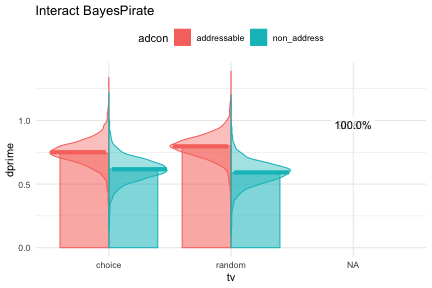
<p class="caption">plot of chunk unnamed-chunk-7</p>
</div>

We can also look at how continuous variables interact at different levels of a factor. The model plots predictions at 10 points along the x axis by default (you can specify different values if pred_values), and reports the probability that there is a non-zero slope to the lines. The plot below shows that there is strong evidence (98%) for a positive slope for age with addressable content, but weaker evidence (92%) for non-addressable content.


```r
bayes_mm_interact(memory_bmm, interacts = c("adcon:age"))
#> Warning: The `at` argument is deprecated and will be removed in the future.
#>   Please use `by` instead.
#> NOTE: Results may be misleading due to involvement in interactions
#> 
#> Interactions: means of levels of   adcon  within levels of  ageEstimated Marginal Means
#> 
#> adcon       |   age | Mean |       95% CI |     pd
#> --------------------------------------------------
#> addressable | 18.00 | 0.63 | [0.38, 0.86] |   100%
#> non_address | 18.00 | 0.50 | [0.26, 0.73] | 99.98%
#> addressable | 23.56 | 0.66 | [0.44, 0.88] |   100%
#> non_address | 23.56 | 0.53 | [0.30, 0.74] |   100%
#> addressable | 29.11 | 0.70 | [0.48, 0.90] |   100%
#> non_address | 29.11 | 0.55 | [0.35, 0.75] |   100%
#> addressable | 34.67 | 0.74 | [0.53, 0.93] |   100%
#> non_address | 34.67 | 0.58 | [0.38, 0.77] |   100%
#> addressable | 40.22 | 0.77 | [0.57, 0.97] |   100%
#> non_address | 40.22 | 0.60 | [0.41, 0.79] |   100%
#> addressable | 45.78 | 0.81 | [0.61, 1.01] |   100%
#> non_address | 45.78 | 0.63 | [0.43, 0.82] |   100%
#> addressable | 51.33 | 0.85 | [0.64, 1.06] |   100%
#> non_address | 51.33 | 0.66 | [0.45, 0.86] |   100%
#> addressable | 56.89 | 0.88 | [0.67, 1.10] |   100%
#> non_address | 56.89 | 0.68 | [0.46, 0.89] |   100%
#> addressable | 62.44 | 0.92 | [0.68, 1.16] |   100%
#> non_address | 62.44 | 0.71 | [0.47, 0.93] |   100%
#> addressable | 68.00 | 0.96 | [0.69, 1.22] |   100%
#> non_address | 68.00 | 0.73 | [0.48, 0.98] |   100%
#> 
#> Marginal means estimated at adcon
#> Warning: The `at` argument is deprecated and will be removed in the future.
#>   Please use `by` instead.
#> NOTE: Results may be misleading due to involvement in interactions
#>          Level1      Level2      age Difference        CI_low   CI_high      pd
#>          <char>      <char>    <num>      <num>         <num>     <num>   <num>
#>  1: addressable non_address 18.00000  0.1280100 -0.0436389725 0.2980909 0.93175
#>  2: addressable non_address 23.55556  0.1375583 -0.0005102599 0.2766184 0.97400
#>  3: addressable non_address 29.11111  0.1477257  0.0366606820 0.2603023 0.99400
#>  4: addressable non_address 34.66667  0.1590350  0.0707916148 0.2484008 0.99950
#>  5: addressable non_address 40.22222  0.1694182  0.0903825045 0.2504100 1.00000
#>  6: addressable non_address 45.77778  0.1807230  0.0938056796 0.2699604 1.00000
#>  7: addressable non_address 51.33333  0.1912488  0.0818719657 0.3017578 0.99950
#>  8: addressable non_address 56.88889  0.2017707  0.0646197547 0.3431169 0.99825
#>  9: addressable non_address 62.44444  0.2120272  0.0451869209 0.3853869 0.99200
#> 10: addressable non_address 68.00000  0.2238910  0.0233251763 0.4316376 0.98550
#>     ROPE_Percentage
#>               <num>
#>  1:      0.36684211
#>  2:      0.27552632
#>  3:      0.16421053
#>  4:      0.07078947
#>  5:      0.02000000
#>  6:      0.01000000
#>  7:      0.02368421
#>  8:      0.04631579
#>  9:      0.07421053
#> 10:      0.09842105
#> Warning: The `at` argument is deprecated and will be removed in the future.
#>   Please use `by` instead.
#> NOTE: Results may be misleading due to involvement in interactions
#> Warning: Removed 2 rows containing missing values or values outside the scale range
#> (`geom_label_repel()`).
#> $`adcon:age`
#> Warning: Removed 2 rows containing missing values or values outside the scale range
#> (`geom_label_repel()`).
```

<div class="figure">
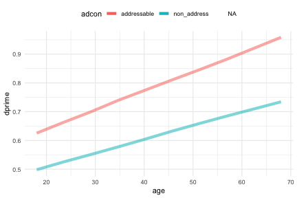
<p class="caption">plot of chunk unnamed-chunk-8</p>
</div>

We can split the data up further using the third factor. This shows a three way interaction, where the adcon:age relationship is split by tv. As well as reporting the MPE for the slope, the function has looked at the evidence for there being a difference at each of the 10 intervals on the x axis. If there is no evidence (MPE<90) that there is a difference between conditions, it colours the region in grey. So the plot below shows that in the tv=choice condition on the left, there is no difference between addressability conditions for people under 30. But a difference emerges after that, since  as people get older, there is strong evidence that their memory for addressable content gets better (98.8%), but  no evidence (71.7%) for a memory effect with non-addressable content. 


```r
bayes_mm_interact(memory_bmm, interacts = "adcon:age:tv")
#> Warning: The `at` argument is deprecated and will be removed in the future.
#>   Please use `by` instead.
#> 
#> Interactions: means of levels of   adcon  within levels of  age tvEstimated Marginal Means
#> 
#> adcon       |     tv |   age | Mean |       95% CI |     pd
#> -----------------------------------------------------------
#> addressable | choice | 18.00 | 0.52 | [0.24, 0.81] | 99.90%
#> non_address | choice | 18.00 | 0.55 | [0.27, 0.84] | 99.90%
#> addressable | random | 18.00 | 0.73 | [0.44, 1.02] |   100%
#> non_address | random | 18.00 | 0.44 | [0.16, 0.73] | 99.70%
#> addressable | choice | 23.56 | 0.58 | [0.32, 0.83] | 99.98%
#> non_address | choice | 23.56 | 0.57 | [0.32, 0.82] |   100%
#> addressable | random | 23.56 | 0.75 | [0.49, 1.00] |   100%
#> non_address | random | 23.56 | 0.48 | [0.22, 0.73] | 99.95%
#> addressable | choice | 29.11 | 0.64 | [0.40, 0.87] |   100%
#> non_address | choice | 29.11 | 0.59 | [0.36, 0.81] |   100%
#> addressable | random | 29.11 | 0.77 | [0.53, 0.98] |   100%
#> non_address | random | 29.11 | 0.52 | [0.28, 0.74] |   100%
#> addressable | choice | 34.67 | 0.69 | [0.48, 0.91] |   100%
#> non_address | choice | 34.67 | 0.60 | [0.39, 0.81] |   100%
#> addressable | random | 34.67 | 0.78 | [0.56, 0.99] |   100%
#> non_address | random | 34.67 | 0.56 | [0.34, 0.76] |   100%
#> addressable | choice | 40.22 | 0.75 | [0.54, 0.96] |   100%
#> non_address | choice | 40.22 | 0.62 | [0.41, 0.82] |   100%
#> addressable | random | 40.22 | 0.80 | [0.58, 1.00] |   100%
#> non_address | random | 40.22 | 0.59 | [0.38, 0.80] |   100%
#> addressable | choice | 45.78 | 0.81 | [0.59, 1.02] |   100%
#> non_address | choice | 45.78 | 0.63 | [0.42, 0.84] |   100%
#> addressable | random | 45.78 | 0.81 | [0.60, 1.02] |   100%
#> non_address | random | 45.78 | 0.63 | [0.42, 0.84] |   100%
#> addressable | choice | 51.33 | 0.86 | [0.63, 1.10] |   100%
#> non_address | choice | 51.33 | 0.65 | [0.42, 0.87] |   100%
#> addressable | random | 51.33 | 0.83 | [0.60, 1.06] |   100%
#> non_address | random | 51.33 | 0.67 | [0.43, 0.90] |   100%
#> addressable | choice | 56.89 | 0.92 | [0.67, 1.18] |   100%
#> non_address | choice | 56.89 | 0.67 | [0.41, 0.91] |   100%
#> addressable | random | 56.89 | 0.84 | [0.60, 1.10] |   100%
#> non_address | random | 56.89 | 0.70 | [0.44, 0.95] |   100%
#> addressable | choice | 62.44 | 0.98 | [0.69, 1.26] |   100%
#> non_address | choice | 62.44 | 0.68 | [0.39, 0.96] |   100%
#> addressable | random | 62.44 | 0.86 | [0.59, 1.15] |   100%
#> non_address | random | 62.44 | 0.74 | [0.45, 1.01] |   100%
#> addressable | choice | 68.00 | 1.04 | [0.71, 1.36] |   100%
#> non_address | choice | 68.00 | 0.70 | [0.37, 1.01] |   100%
#> addressable | random | 68.00 | 0.88 | [0.57, 1.21] |   100%
#> non_address | random | 68.00 | 0.77 | [0.44, 1.09] |   100%
#> 
#> Marginal means estimated at adcon
#> Warning: The `at` argument is deprecated and will be removed in the future.
#>   Please use `by` instead.
#>          Level1      Level2      age     tv   Difference      CI_low   CI_high
#>          <char>      <char>    <num> <fctr>        <num>       <num>     <num>
#>  1: addressable non_address 18.00000 choice -0.031227989 -0.26026046 0.2033988
#>  2: addressable non_address 23.55556 choice  0.009988586 -0.17664462 0.2008951
#>  3: addressable non_address 29.11111 choice  0.050463912 -0.10008872 0.1991805
#>  4: addressable non_address 34.66667 choice  0.092623653 -0.03108511 0.2141375
#>  5: addressable non_address 40.22222 choice  0.133691336  0.01912915 0.2454344
#>  6: addressable non_address 45.77778 choice  0.175041470  0.04924525 0.3047086
#>  7: addressable non_address 51.33333 choice  0.215876364  0.06090776 0.3762830
#>  8: addressable non_address 56.88889 choice  0.258129720  0.06307641 0.4642096
#>  9: addressable non_address 62.44444 choice  0.299625790  0.06402756 0.5496847
#> 10: addressable non_address 68.00000 choice  0.341218599  0.06191547 0.6361289
#> 11: addressable non_address 18.00000 random  0.287800733  0.03461360 0.5377068
#> 12: addressable non_address 23.55556 random  0.267720851  0.05828247 0.4715197
#> 13: addressable non_address 29.11111 random  0.246900650  0.07889431 0.4123981
#> 14: addressable non_address 34.66667 random  0.225887130  0.09561098 0.3587566
#> 15: addressable non_address 40.22222 random  0.204768513  0.09141928 0.3224733
#> 16: addressable non_address 45.77778 random  0.186511264  0.06274807 0.3105271
#> 17: addressable non_address 51.33333 random  0.166220178  0.01515785 0.3160975
#> 18: addressable non_address 56.88889 random  0.145146507 -0.04168870 0.3333193
#> 19: addressable non_address 62.44444 random  0.125484995 -0.10644143 0.3618168
#> 20: addressable non_address 68.00000 random  0.104914526 -0.17243543 0.3969840
#>          Level1      Level2      age     tv   Difference      CI_low   CI_high
#>          pd ROPE_Percentage
#>       <num>           <num>
#>  1: 0.61050     0.622105263
#>  2: 0.54025     0.734736842
#>  3: 0.74950     0.748947368
#>  4: 0.92925     0.547894737
#>  5: 0.98775     0.270789474
#>  6: 0.99500     0.102105263
#>  7: 0.99500     0.052894737
#>  8: 0.99475     0.035526316
#>  9: 0.99175     0.029473684
#> 10: 0.99050     0.026315789
#> 11: 0.98350     0.049210526
#> 12: 0.99300     0.030263158
#> 13: 0.99750     0.014736842
#> 14: 0.99950     0.005000000
#> 15: 0.99975     0.009736842
#> 16: 0.99825     0.058947368
#> 17: 0.98375     0.179473684
#> 18: 0.93400     0.302105263
#> 19: 0.85550     0.409736842
#> 20: 0.76825     0.432368421
#>          pd ROPE_Percentage
#> Warning: The `at` argument is deprecated and will be removed in the future.
#>   Please use `by` instead.
#> Warning: Removed 4 rows containing missing values or values outside the scale range
#> (`geom_label_repel()`).
#> $`adcon:age:tv`
#> Warning: Removed 4 rows containing missing values or values outside the scale range
#> (`geom_label_repel()`).
```

<div class="figure">
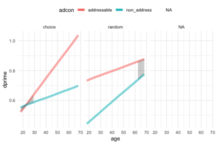
<p class="caption">plot of chunk unnamed-chunk-9</p>
</div>
We can get more fine grained information about those interval differences by displaying them all in a ladder with all the MPEs 


```r
bayes_mm_interact(memory_bmm, interacts = "adcon:age:tv",ladder=T,ribbon=F)
#> Warning: The `at` argument is deprecated and will be removed in the future.
#>   Please use `by` instead.
#> 
#> Interactions: means of levels of   adcon  within levels of  age tvEstimated Marginal Means
#> 
#> adcon       |     tv |   age | Mean |       95% CI |     pd
#> -----------------------------------------------------------
#> addressable | choice | 18.00 | 0.52 | [0.24, 0.81] | 99.90%
#> non_address | choice | 18.00 | 0.55 | [0.27, 0.84] | 99.90%
#> addressable | random | 18.00 | 0.73 | [0.44, 1.02] |   100%
#> non_address | random | 18.00 | 0.44 | [0.16, 0.73] | 99.70%
#> addressable | choice | 23.56 | 0.58 | [0.32, 0.83] | 99.98%
#> non_address | choice | 23.56 | 0.57 | [0.32, 0.82] |   100%
#> addressable | random | 23.56 | 0.75 | [0.49, 1.00] |   100%
#> non_address | random | 23.56 | 0.48 | [0.22, 0.73] | 99.95%
#> addressable | choice | 29.11 | 0.64 | [0.40, 0.87] |   100%
#> non_address | choice | 29.11 | 0.59 | [0.36, 0.81] |   100%
#> addressable | random | 29.11 | 0.77 | [0.53, 0.98] |   100%
#> non_address | random | 29.11 | 0.52 | [0.28, 0.74] |   100%
#> addressable | choice | 34.67 | 0.69 | [0.48, 0.91] |   100%
#> non_address | choice | 34.67 | 0.60 | [0.39, 0.81] |   100%
#> addressable | random | 34.67 | 0.78 | [0.56, 0.99] |   100%
#> non_address | random | 34.67 | 0.56 | [0.34, 0.76] |   100%
#> addressable | choice | 40.22 | 0.75 | [0.54, 0.96] |   100%
#> non_address | choice | 40.22 | 0.62 | [0.41, 0.82] |   100%
#> addressable | random | 40.22 | 0.80 | [0.58, 1.00] |   100%
#> non_address | random | 40.22 | 0.59 | [0.38, 0.80] |   100%
#> addressable | choice | 45.78 | 0.81 | [0.59, 1.02] |   100%
#> non_address | choice | 45.78 | 0.63 | [0.42, 0.84] |   100%
#> addressable | random | 45.78 | 0.81 | [0.60, 1.02] |   100%
#> non_address | random | 45.78 | 0.63 | [0.42, 0.84] |   100%
#> addressable | choice | 51.33 | 0.86 | [0.63, 1.10] |   100%
#> non_address | choice | 51.33 | 0.65 | [0.42, 0.87] |   100%
#> addressable | random | 51.33 | 0.83 | [0.60, 1.06] |   100%
#> non_address | random | 51.33 | 0.67 | [0.43, 0.90] |   100%
#> addressable | choice | 56.89 | 0.92 | [0.67, 1.18] |   100%
#> non_address | choice | 56.89 | 0.67 | [0.41, 0.91] |   100%
#> addressable | random | 56.89 | 0.84 | [0.60, 1.10] |   100%
#> non_address | random | 56.89 | 0.70 | [0.44, 0.95] |   100%
#> addressable | choice | 62.44 | 0.98 | [0.69, 1.26] |   100%
#> non_address | choice | 62.44 | 0.68 | [0.39, 0.96] |   100%
#> addressable | random | 62.44 | 0.86 | [0.59, 1.15] |   100%
#> non_address | random | 62.44 | 0.74 | [0.45, 1.01] |   100%
#> addressable | choice | 68.00 | 1.04 | [0.71, 1.36] |   100%
#> non_address | choice | 68.00 | 0.70 | [0.37, 1.01] |   100%
#> addressable | random | 68.00 | 0.88 | [0.57, 1.21] |   100%
#> non_address | random | 68.00 | 0.77 | [0.44, 1.09] |   100%
#> 
#> Marginal means estimated at adcon
#> Warning: The `at` argument is deprecated and will be removed in the future.
#>   Please use `by` instead.
#>          Level1      Level2      age     tv   Difference      CI_low   CI_high
#>          <char>      <char>    <num> <fctr>        <num>       <num>     <num>
#>  1: addressable non_address 18.00000 choice -0.031227989 -0.26026046 0.2033988
#>  2: addressable non_address 23.55556 choice  0.009988586 -0.17664462 0.2008951
#>  3: addressable non_address 29.11111 choice  0.050463912 -0.10008872 0.1991805
#>  4: addressable non_address 34.66667 choice  0.092623653 -0.03108511 0.2141375
#>  5: addressable non_address 40.22222 choice  0.133691336  0.01912915 0.2454344
#>  6: addressable non_address 45.77778 choice  0.175041470  0.04924525 0.3047086
#>  7: addressable non_address 51.33333 choice  0.215876364  0.06090776 0.3762830
#>  8: addressable non_address 56.88889 choice  0.258129720  0.06307641 0.4642096
#>  9: addressable non_address 62.44444 choice  0.299625790  0.06402756 0.5496847
#> 10: addressable non_address 68.00000 choice  0.341218599  0.06191547 0.6361289
#> 11: addressable non_address 18.00000 random  0.287800733  0.03461360 0.5377068
#> 12: addressable non_address 23.55556 random  0.267720851  0.05828247 0.4715197
#> 13: addressable non_address 29.11111 random  0.246900650  0.07889431 0.4123981
#> 14: addressable non_address 34.66667 random  0.225887130  0.09561098 0.3587566
#> 15: addressable non_address 40.22222 random  0.204768513  0.09141928 0.3224733
#> 16: addressable non_address 45.77778 random  0.186511264  0.06274807 0.3105271
#> 17: addressable non_address 51.33333 random  0.166220178  0.01515785 0.3160975
#> 18: addressable non_address 56.88889 random  0.145146507 -0.04168870 0.3333193
#> 19: addressable non_address 62.44444 random  0.125484995 -0.10644143 0.3618168
#> 20: addressable non_address 68.00000 random  0.104914526 -0.17243543 0.3969840
#>          Level1      Level2      age     tv   Difference      CI_low   CI_high
#>          pd ROPE_Percentage
#>       <num>           <num>
#>  1: 0.61050     0.622105263
#>  2: 0.54025     0.734736842
#>  3: 0.74950     0.748947368
#>  4: 0.92925     0.547894737
#>  5: 0.98775     0.270789474
#>  6: 0.99500     0.102105263
#>  7: 0.99500     0.052894737
#>  8: 0.99475     0.035526316
#>  9: 0.99175     0.029473684
#> 10: 0.99050     0.026315789
#> 11: 0.98350     0.049210526
#> 12: 0.99300     0.030263158
#> 13: 0.99750     0.014736842
#> 14: 0.99950     0.005000000
#> 15: 0.99975     0.009736842
#> 16: 0.99825     0.058947368
#> 17: 0.98375     0.179473684
#> 18: 0.93400     0.302105263
#> 19: 0.85550     0.409736842
#> 20: 0.76825     0.432368421
#>          pd ROPE_Percentage
#> Warning: The `at` argument is deprecated and will be removed in the future.
#>   Please use `by` instead.
#> Warning: Removed 4 rows containing missing values or values outside the scale range
#> (`geom_label_repel()`).
#> $`adcon:age:tv`
#> Warning: Removed 4 rows containing missing values or values outside the scale range
#> (`geom_label_repel()`).
```

<div class="figure">
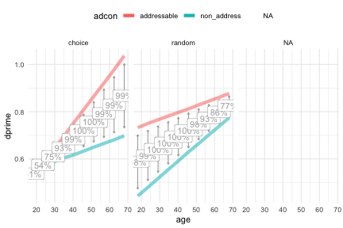
<p class="caption">plot of chunk unnamed-chunk-10</p>
</div>

## Bayes_mm wrapper function to run and analyse data

All the functions above can be carried out by a single, wrapper function, bayes_mm(). This will first run the model, then plot all the main effects and all the interactions. It will also output various model metrics that can be used in reporting, and plot the traces if asked. Here is an analysis for how people rated the adverts, run in one line. I've also asked for plots of the traces to check convergence. If you wanted to see more, you can use explore_browser=TRUE. 


```r
rating_bmm <- bayes_mm(data = data,dvname="rating",conditions = c("adcon","dim","tv"),groups = c("pid"),plotcheck = T)
#> [1] "running model"
#> Bayes Mixed model on  rating  by  adcon dim tv  nested in  pid
#> ================================================================================
#> 
#> stan_glmer
#>  family:       gaussian [identity]
#>  formula:      rating ~ adcon * dim * tv + (1 | pid)
#>  observations: 804
#> ------
#>                                     Median MAD_SD
#> (Intercept)                          1.8    0.4  
#> adconnon_address                    -0.8    0.6  
#> dimcruise                            0.4    0.6  
#> dimdog                              -0.5    0.6  
#> dimgames                             0.9    0.6  
#> tvrandom                            -1.0    0.6  
#> adconnon_address:dimcruise          -0.4    0.8  
#> adconnon_address:dimdog             -0.7    0.9  
#> adconnon_address:dimgames           -3.6    0.9  
#> adconnon_address:tvrandom            0.7    0.8  
#> dimcruise:tvrandom                   0.6    0.8  
#> dimdog:tvrandom                      1.4    0.8  
#> dimgames:tvrandom                    0.2    0.8  
#> adconnon_address:dimcruise:tvrandom -1.2    1.2  
#> adconnon_address:dimdog:tvrandom    -0.1    1.2  
#> adconnon_address:dimgames:tvrandom   0.6    1.3  
#> 
#> Auxiliary parameter(s):
#>       Median MAD_SD
#> sigma 2.7    0.1   
#> 
#> Error terms:
#>  Groups   Name        Std.Dev.
#>  pid      (Intercept) 2.0     
#>  Residual             2.7     
#> Num. levels: pid 201 
#> 
#> ------
#> * For help interpreting the printed output see ?print.stanreg
#> * For info on the priors used see ?prior_summary.stanreg
#> 
#> Priors for model 'bmm' 
#> ------
#> Intercept (after predictors centered)
#>   Specified prior:
#>     ~ normal(location = 0.89, scale = 2.5)
#>   Adjusted prior:
#>     ~ normal(location = 0.89, scale = 8.7)
#> 
#> Coefficients
#>   Specified prior:
#>     ~ normal(location = [0,0,0,...], scale = [2.5,2.5,2.5,...])
#>   Adjusted prior:
#>     ~ normal(location = [0,0,0,...], scale = [17.44,20.14,20.14,...])
#> 
#> Auxiliary (sigma)
#>   Specified prior:
#>     ~ exponential(rate = 1)
#>   Adjusted prior:
#>     ~ exponential(rate = 0.29)
#> 
#> Covariance
#>  ~ decov(reg. = 1, conc. = 1, shape = 1, scale = 1)
#> ------
#> See help('prior_summary.stanreg') for more details
#> 
#> Parameter                           | Median |         95% CI |     pd |  Rhat
#> ------------------------------------------------------------------------------
#> (Intercept)                         |   1.78 | [ 0.97,  2.55] | 99.98% | 1.003
#> adconnon_address                    |  -0.82 | [-2.00,  0.39] | 90.62% | 1.004
#> dimcruise                           |   0.41 | [-0.64,  1.50] | 78.00% | 1.002
#> dimdog                              |  -0.49 | [-1.64,  0.67] | 80.05% | 1.003
#> dimgames                            |   0.85 | [-0.22,  1.93] | 94.58% | 1.002
#> tvrandom                            |  -1.02 | [-2.21,  0.17] | 95.60% | 1.002
#> adconnon_address:dimcruise          |  -0.45 | [-2.13,  1.17] | 70.53% | 1.003
#> adconnon_address:dimdog             |  -0.66 | [-2.41,  1.07] | 75.55% | 1.004
#> adconnon_address:dimgames           |  -3.60 | [-5.30, -1.85] |   100% | 1.002
#> adconnon_address:tvrandom           |   0.72 | [-0.96,  2.31] | 79.97% | 1.005
#> dimcruise:tvrandom                  |   0.64 | [-0.87,  2.18] | 78.50% | 1.001
#> dimdog:tvrandom                     |   1.39 | [-0.23,  2.92] | 95.70% | 1.003
#> dimgames:tvrandom                   |   0.21 | [-1.31,  1.92] | 61.02% | 1.002
#> adconnon_address:dimcruise:tvrandom |  -1.16 | [-3.50,  1.18] | 83.30% | 1.003
#> adconnon_address:dimdog:tvrandom    |  -0.10 | [-2.55,  2.39] | 53.05% | 1.004
#> adconnon_address:dimgames:tvrandom  |   0.56 | [-1.95,  2.96] | 67.22% | 1.002
#> 
#> Parameter                           |     ESS |                  Prior
#> ----------------------------------------------------------------------
#> (Intercept)                         | 1080.00 |  Normal (0.89 +- 8.73)
#> adconnon_address                    |  974.00 | Normal (0.00 +- 17.44)
#> dimcruise                           | 1347.00 | Normal (0.00 +- 20.14)
#> dimdog                              | 1456.00 | Normal (0.00 +- 20.14)
#> dimgames                            | 1323.00 | Normal (0.00 +- 20.14)
#> tvrandom                            | 1063.00 | Normal (0.00 +- 17.45)
#> adconnon_address:dimcruise          | 1106.00 | Normal (0.00 +- 25.78)
#> adconnon_address:dimdog             | 1179.00 | Normal (0.00 +- 25.99)
#> adconnon_address:dimgames           | 1111.00 | Normal (0.00 +- 26.54)
#> adconnon_address:tvrandom           |  898.00 | Normal (0.00 +- 20.24)
#> dimcruise:tvrandom                  | 1329.00 | Normal (0.00 +- 26.54)
#> dimdog:tvrandom                     | 1370.00 | Normal (0.00 +- 26.54)
#> dimgames:tvrandom                   | 1278.00 | Normal (0.00 +- 26.54)
#> adconnon_address:dimcruise:tvrandom | 1086.00 | Normal (0.00 +- 35.46)
#> adconnon_address:dimdog:tvrandom    | 1258.00 | Normal (0.00 +- 37.94)
#> adconnon_address:dimgames:tvrandom  | 1070.00 | Normal (0.00 +- 36.12)
#> 
#> Uncertainty intervals (equal-tailed) and p-values (two-tailed) computed
#>   using a MCMC distribution approximation.
#> NOTE: Results may be misleading due to involvement in interactions
#> 
#> Main effects means:  adcon 
#> Estimated Marginal Means
#> 
#> adcon       | Mean |        95% CI |     pd
#> -------------------------------------------
#> addressable | 1.75 | [ 1.36, 2.14] |   100%
#> non_address | 0.03 | [-0.38, 0.41] | 55.27%
#> 
#> Marginal means estimated at adcon
#> NOTE: Results may be misleading due to involvement in interactions
#> 
#> Main effects contrasts:  adcon 
#> Marginal Contrasts Analysis
#> 
#> Level1      |      Level2 | Difference |       95% CI |   pd | % in ROPE
#> ------------------------------------------------------------------------
#> addressable | non_address |       1.72 | [1.35, 2.09] | 100% |        0%
#> 
#> Marginal contrasts estimated at adcon
#> NOTE: Results may be misleading due to involvement in interactions
#> NOTE: Results may be misleading due to involvement in interactions
#> 
#> Main effects means:  dim 
#> Estimated Marginal Means
#> 
#> dim    | Mean |        95% CI |     pd
#> --------------------------------------
#> car    | 1.04 | [ 0.57, 1.51] |   100%
#> cruise | 1.27 | [ 0.81, 1.73] |   100%
#> dog    | 0.89 | [ 0.42, 1.36] |   100%
#> games  | 0.36 | [-0.09, 0.82] | 93.20%
#> 
#> Marginal means estimated at dim
#> NOTE: Results may be misleading due to involvement in interactions
#> 
#> Main effects contrasts:  dim 
#> Marginal Contrasts Analysis
#> 
#> Level1 | Level2 | Difference |        95% CI |     pd | % in ROPE
#> -----------------------------------------------------------------
#> car    | cruise |      -0.23 | [-0.74, 0.29] | 80.38% |    21.47%
#> car    |    dog |       0.15 | [-0.39, 0.67] | 71.12% |    25.82%
#> car    |  games |       0.68 | [ 0.15, 1.19] | 99.40% |        0%
#> cruise |    dog |       0.37 | [-0.14, 0.90] | 92.17% |    12.21%
#> cruise |  games |       0.91 | [ 0.40, 1.42] | 99.95% |        0%
#> dog    |  games |       0.53 | [-0.01, 1.04] | 97.30% |     2.79%
#> 
#> Marginal contrasts estimated at dim
#> NOTE: Results may be misleading due to involvement in interactions
#> NOTE: Results may be misleading due to involvement in interactions
#> 
#> Main effects means:  tv 
#> Estimated Marginal Means
#> 
#> tv     | Mean |       95% CI |   pd
#> -----------------------------------
#> choice | 0.98 | [0.49, 1.46] | 100%
#> random | 0.80 | [0.32, 1.29] | 100%
#> 
#> Marginal means estimated at tv
#> NOTE: Results may be misleading due to involvement in interactions
#> 
#> Main effects contrasts:  tv 
#> Marginal Contrasts Analysis
#> 
#> Level1 | Level2 | Difference |        95% CI |     pd | % in ROPE
#> -----------------------------------------------------------------
#> choice | random |       0.19 | [-0.49, 0.84] | 70.85% |    20.92%
#> 
#> Marginal contrasts estimated at tv
#> NOTE: Results may be misleading due to involvement in interactions
#> Warning in set(x, j = name, value = value): Tried to assign NULL to column
#> 'pid', but this column does not exist to remove
#> Warning: The `at` argument is deprecated and will be removed in the future.
#>   Please use `by` instead.
#> NOTE: Results may be misleading due to involvement in interactions
#> 
#> Interactions: means of levels of   adcon  within levels of  dimEstimated Marginal Means
#> 
#> adcon       |    dim |  Mean |         95% CI |     pd
#> ------------------------------------------------------
#> addressable |    car |  1.28 | [ 0.66,  1.88] | 99.98%
#> non_address |    car |  0.81 | [ 0.15,  1.47] | 99.45%
#> addressable | cruise |  2.01 | [ 1.40,  2.63] |   100%
#> non_address | cruise |  0.52 | [-0.10,  1.10] | 94.53%
#> addressable |    dog |  1.47 | [ 0.84,  2.10] |   100%
#> non_address |    dog |  0.31 | [-0.31,  0.93] | 83.58%
#> addressable |  games |  2.25 | [ 1.62,  2.86] |   100%
#> non_address |  games | -1.53 | [-2.15, -0.90] |   100%
#> 
#> Marginal means estimated at adcon
#> Warning: The `at` argument is deprecated and will be removed in the future.
#>   Please use `by` instead.
#> NOTE: Results may be misleading due to involvement in interactions
#> 
#> Interations: contrasts between levels of   adcon  within levels of  dimMarginal Contrasts Analysis
#> 
#> Level1      |      Level2 |    dim | Difference |        95% CI |     pd | % in ROPE
#> ------------------------------------------------------------------------------------
#> addressable | non_address |    car |       0.46 | [-0.40, 1.33] | 86.22% |    10.55%
#> addressable | non_address | cruise |       1.49 | [ 0.72, 2.32] | 99.98% |        0%
#> addressable | non_address |    dog |       1.16 | [ 0.32, 1.98] | 99.62% |        0%
#> addressable | non_address |  games |       3.78 | [ 2.93, 4.58] |   100% |        0%
#> 
#> Marginal contrasts estimated at adcon
#> NOTE: Results may be misleading due to involvement in interactions
#> Warning: The `at` argument is deprecated and will be removed in the future.
#>   Please use `by` instead.
#> NOTE: Results may be misleading due to involvement in interactions
#> 
#> Interactions: means of levels of   adcon  within levels of  tvEstimated Marginal Means
#> 
#> adcon       |     tv |      Mean |        95% CI |     pd
#> ---------------------------------------------------------
#> addressable | choice |      1.98 | [ 1.43, 2.51] |   100%
#> non_address | choice | -9.71e-03 | [-0.56, 0.52] | 51.65%
#> addressable | random |      1.52 | [ 0.98, 2.07] |   100%
#> non_address | random |      0.07 | [-0.49, 0.63] | 60.05%
#> 
#> Marginal means estimated at adcon
#> Warning: The `at` argument is deprecated and will be removed in the future.
#>   Please use `by` instead.
#> NOTE: Results may be misleading due to involvement in interactions
#> 
#> Interations: contrasts between levels of   adcon  within levels of  tvMarginal Contrasts Analysis
#> 
#> Level1      |      Level2 |     tv | Difference |       95% CI |   pd | % in ROPE
#> ---------------------------------------------------------------------------------
#> addressable | non_address | choice |       1.99 | [1.49, 2.51] | 100% |        0%
#> addressable | non_address | random |       1.45 | [0.92, 1.98] | 100% |        0%
#> 
#> Marginal contrasts estimated at adcon
#> NOTE: Results may be misleading due to involvement in interactions
#> Warning: The `at` argument is deprecated and will be removed in the future.
#>   Please use `by` instead.
#> 
#> Interactions: means of levels of   adcon  within levels of  dim tvEstimated Marginal Means
#> 
#> adcon       |    dim |     tv |  Mean |         95% CI |     pd
#> ---------------------------------------------------------------
#> addressable |    car | choice |  1.78 | [ 0.97,  2.55] | 99.98%
#> non_address |    car | choice |  0.96 | [ 0.00,  1.91] | 97.55%
#> addressable | cruise | choice |  2.20 | [ 1.31,  3.10] |   100%
#> non_address | cruise | choice |  0.93 | [ 0.09,  1.76] | 98.60%
#> addressable |    dog | choice |  1.29 | [ 0.38,  2.23] | 99.65%
#> non_address |    dog | choice | -0.18 | [-1.00,  0.67] | 66.45%
#> addressable |  games | choice |  2.64 | [ 1.79,  3.51] |   100%
#> non_address |  games | choice | -1.77 | [-2.64, -0.90] |   100%
#> addressable |    car | random |  0.75 | [-0.13,  1.65] | 95.10%
#> non_address |    car | random |  0.65 | [-0.21,  1.53] | 92.62%
#> addressable | cruise | random |  1.82 | [ 0.95,  2.71] |   100%
#> non_address | cruise | random |  0.11 | [-0.77,  0.97] | 59.67%
#> addressable |    dog | random |  1.65 | [ 0.79,  2.51] |   100%
#> non_address |    dog | random |  0.79 | [-0.16,  1.75] | 95.65%
#> addressable |  games | random |  1.86 | [ 0.97,  2.74] |   100%
#> non_address |  games | random | -1.29 | [-2.14, -0.42] | 99.67%
#> 
#> Marginal means estimated at adcon
#> Warning: The `at` argument is deprecated and will be removed in the future.
#>   Please use `by` instead.
#> 
#> Interations: contrasts between levels of   adcon  within levels of  dim tvMarginal Contrasts Analysis
#> 
#> Level1      |      Level2 |    dim |     tv | Difference |        95% CI
#> ------------------------------------------------------------------------
#> addressable | non_address |    car | choice |       0.82 | [-0.39, 2.00]
#> addressable | non_address | cruise | choice |       1.28 | [ 0.15, 2.44]
#> addressable | non_address |    dog | choice |       1.47 | [ 0.29, 2.64]
#> addressable | non_address |  games | choice |       4.41 | [ 3.24, 5.54]
#> addressable | non_address |    car | random |       0.11 | [-1.07, 1.28]
#> addressable | non_address | cruise | random |       1.71 | [ 0.55, 2.88]
#> addressable | non_address |    dog | random |       0.84 | [-0.32, 2.04]
#> addressable | non_address |  games | random |       3.15 | [ 1.96, 4.27]
#> 
#> Level1      |     pd | % in ROPE
#> --------------------------------
#> addressable | 90.62% |     5.45%
#> addressable | 98.78% |        0%
#> addressable | 99.30% |        0%
#> addressable |   100% |        0%
#> addressable | 57.30% |    13.32%
#> addressable | 99.75% |        0%
#> addressable | 92.12% |     5.00%
#> addressable |   100% |        0%
#> 
#> Marginal contrasts estimated at adcon
```

<div class="figure">
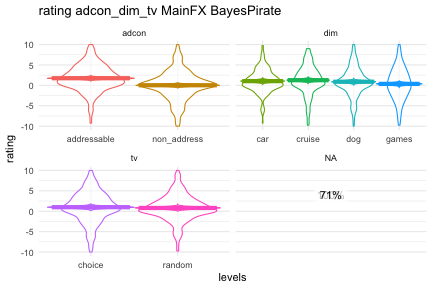
<p class="caption">plot of chunk unnamed-chunk-11</p>
</div>

```
#> $`adcon:dim`
```

<div class="figure">
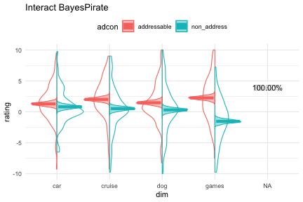
<p class="caption">plot of chunk unnamed-chunk-11</p>
</div>

```
#> 
#> $`adcon:tv`
```

<div class="figure">
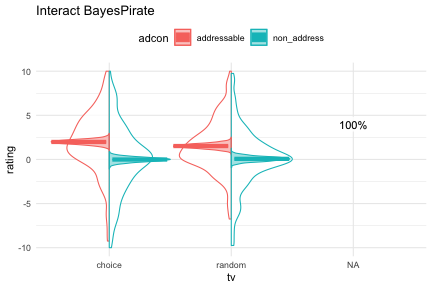
<p class="caption">plot of chunk unnamed-chunk-11</p>
</div>

```
#> 
#> $`adcon:dim:tv`
```

<div class="figure">
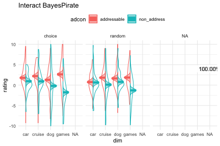
<p class="caption">plot of chunk unnamed-chunk-11</p>
</div>

Since we have saved the output of the model, we can then do follow up analyses to replot and look at things of interest, by passing the model back through one of our plotting functions. Here's the three way interaction:


```r
bayes_mm_interact(rating_bmm,interacts = "adcon:dim:tv",violin=F,contrast_sparkline = T,show_mpe  = F)
#> Warning: The `at` argument is deprecated and will be removed in the future.
#>   Please use `by` instead.
#> 
#> Interactions: means of levels of   adcon  within levels of  dim tvEstimated Marginal Means
#> 
#> adcon       |    dim |     tv |  Mean |         95% CI |     pd
#> ---------------------------------------------------------------
#> addressable |    car | choice |  1.78 | [ 0.97,  2.55] | 99.98%
#> non_address |    car | choice |  0.96 | [ 0.00,  1.91] | 97.55%
#> addressable | cruise | choice |  2.20 | [ 1.31,  3.10] |   100%
#> non_address | cruise | choice |  0.93 | [ 0.09,  1.76] | 98.60%
#> addressable |    dog | choice |  1.29 | [ 0.38,  2.23] | 99.65%
#> non_address |    dog | choice | -0.18 | [-1.00,  0.67] | 66.45%
#> addressable |  games | choice |  2.64 | [ 1.79,  3.51] |   100%
#> non_address |  games | choice | -1.77 | [-2.64, -0.90] |   100%
#> addressable |    car | random |  0.75 | [-0.13,  1.65] | 95.10%
#> non_address |    car | random |  0.65 | [-0.21,  1.53] | 92.62%
#> addressable | cruise | random |  1.82 | [ 0.95,  2.71] |   100%
#> non_address | cruise | random |  0.11 | [-0.77,  0.97] | 59.67%
#> addressable |    dog | random |  1.65 | [ 0.79,  2.51] |   100%
#> non_address |    dog | random |  0.79 | [-0.16,  1.75] | 95.65%
#> addressable |  games | random |  1.86 | [ 0.97,  2.74] |   100%
#> non_address |  games | random | -1.29 | [-2.14, -0.42] | 99.67%
#> 
#> Marginal means estimated at adcon
#> Warning: The `at` argument is deprecated and will be removed in the future.
#>   Please use `by` instead.
#> 
#> Interations: contrasts between levels of   adcon  within levels of  dim tvMarginal Contrasts Analysis
#> 
#> Level1      |      Level2 |    dim |     tv | Difference |        95% CI
#> ------------------------------------------------------------------------
#> addressable | non_address |    car | choice |       0.82 | [-0.39, 2.00]
#> addressable | non_address | cruise | choice |       1.28 | [ 0.15, 2.44]
#> addressable | non_address |    dog | choice |       1.47 | [ 0.29, 2.64]
#> addressable | non_address |  games | choice |       4.41 | [ 3.24, 5.54]
#> addressable | non_address |    car | random |       0.11 | [-1.07, 1.28]
#> addressable | non_address | cruise | random |       1.71 | [ 0.55, 2.88]
#> addressable | non_address |    dog | random |       0.84 | [-0.32, 2.04]
#> addressable | non_address |  games | random |       3.15 | [ 1.96, 4.27]
#> 
#> Level1      |     pd | % in ROPE
#> --------------------------------
#> addressable | 90.62% |     5.45%
#> addressable | 98.78% |        0%
#> addressable | 99.30% |        0%
#> addressable |   100% |        0%
#> addressable | 57.30% |    13.32%
#> addressable | 99.75% |        0%
#> addressable | 92.12% |     5.00%
#> addressable |   100% |        0%
#> 
#> Marginal contrasts estimated at adcon
#> $`adcon:dim:tv`
```

<div class="figure">
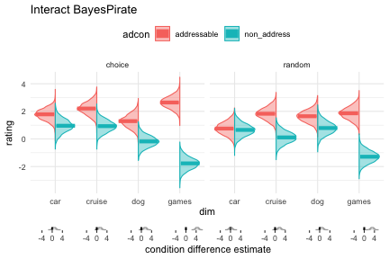
<p class="caption">plot of chunk unnamed-chunk-12</p>
</div>

If you run into any problems, please raise an issue with github!
